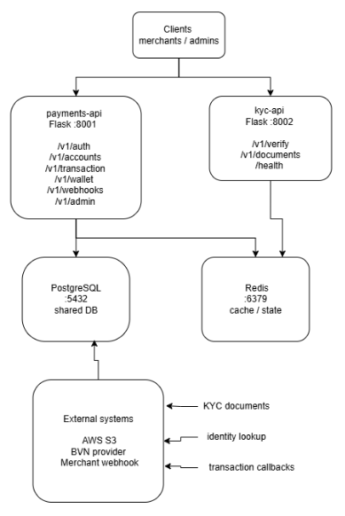
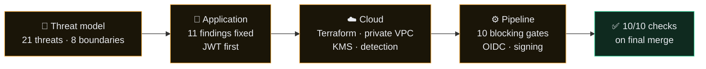
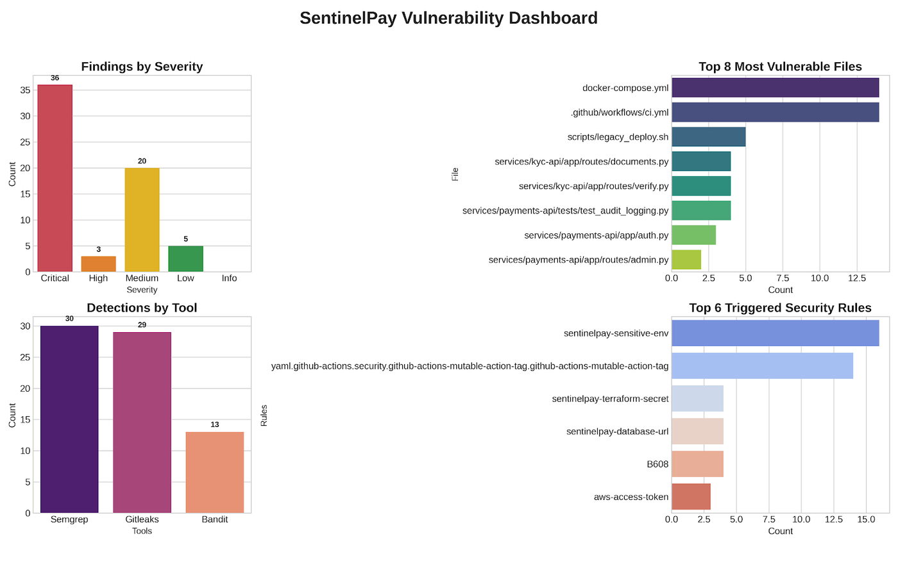
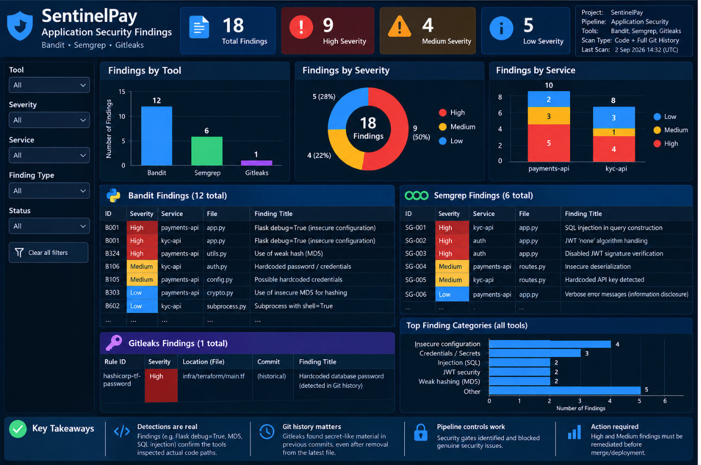
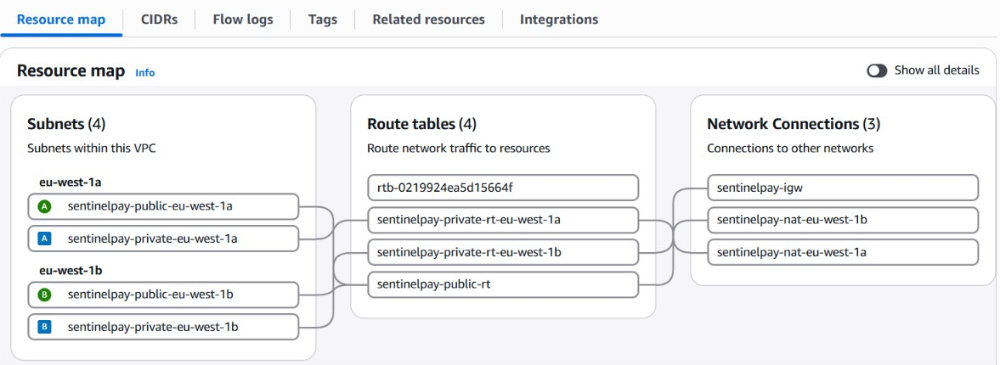
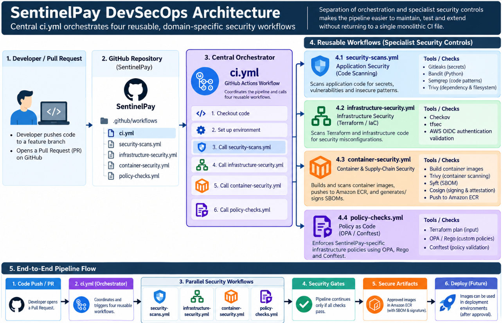
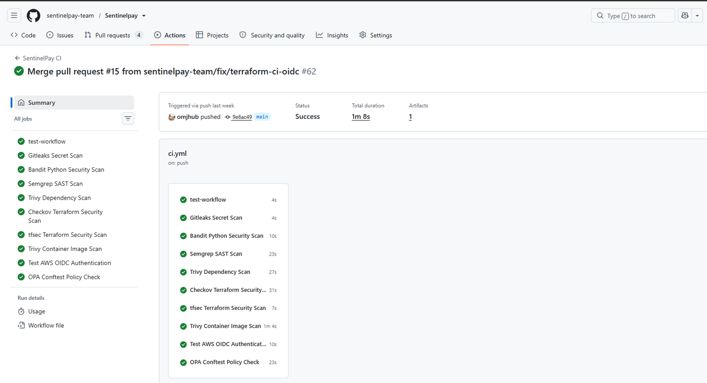

# SentinelPay: Securing an Inherited Fintech Platform

-2ea44f)


A five-person security engineering team brought in to secure a payments and KYC platform after an external researcher disclosed an IDOR vulnerability in production. Over seven three-day cycles we fixed every application finding, rebuilt the AWS environment in Terraform with private networking, encryption and detection, and put a ten-gate CI/CD pipeline in front of `main` with keyless AWS access and signed container images.

**Final result: 21 threats modelled, 11 of 11 application findings closed, and 10 of 10 required security checks passing on the final merge to `main`.**

---

## Contents

- [The brief](#the-brief)
- [Team](#team)
- [My role as Team Lead](#my-role-as-team-lead)
- [Approach](#approach)
- [Threat model](#threat-model)
- [Application security: 11 of 11 closed](#application-security-11-of-11-closed)
- [Cloud infrastructure and detection](#cloud-infrastructure-and-detection)
- [DevSecOps pipeline: ten gates](#devsecops-pipeline-ten-gates)
- [The pipeline failing correctly](#the-pipeline-failing-correctly)
- [Results](#results)
- [Tech stack](#tech-stack)
- [Repository structure](#repository-structure)
- [Open items before production](#open-items-before-production)
- [Lessons learned](#lessons-learned)

---

## The brief

| | |
| --- | --- |
| **Client brief** | SentinelPay Technologies: a pan-African fintech processing card and bank-transfer payments for around 1,400 merchants across Nigeria, Ghana, Kenya and Rwanda |
| **Trigger** | An external researcher showed that one logged-in user could read another user's transactions by changing an ID in the request (IDOR) |
| **What we found** | The IDOR was one symptom of a wider pattern: forgeable JWTs, unparameterised queries, a wallet race condition, no audit logging, and no review or scanning on any change to code, infrastructure or pipeline |
| **Region** | AWS eu-west-1 |

<p align="center"></p>

The system: two Flask services (`payments-api` and `kyc-api`) sharing PostgreSQL and Redis, with S3 for KYC documents, a BVN identity provider and merchant webhooks.

---

## Team

| Role | Member | Owns |
| --- | --- | --- |
| **Team Lead** | **Omajuwa Okotie** | Threat model, cycle planning and sequencing, review and approval of every PR, key decisions, sign-off |
| AppSec Engineer | Chinaza | Code review and all application fixes |
| Cloud Engineer: Network and Compute | Femi | VPC, ECS Fargate, ALB |
| Cloud Engineer: Data, Identity and Detection | Ben | KMS, RDS, Secrets Manager, OIDC, detection stack |
| DevSecOps Engineer | Mohammed | CI/CD gates, policy as code, image signing |

---

## My role as Team Lead

- **Led the threat model myself.** Ran live STRIDE sessions on the actual source code with the whole team, so disagreements about what the code did were settled on the call, not baked into the register. Then walked the team through every threat and the fix order.
- **Planned seven three-day cycles**, each ending in a review meeting with one specific decision attached, so gaps surfaced early.
- **Set the fix order from the register.** JWT validation was fixed first, ahead of findings that looked more severe in isolation, because admin self-promotion and pickle-based remote code execution were only easily reachable while JWT validation was broken.
- **Set up branch protection** so every change to `main` needed a pull request, a review and passing checks, then **reviewed and approved every pull request** and set the merge order by dependency: application fixes, then cloud identity and data, then the full pipeline gates.
- **Worked through problems one to one and on calls**, including issues between tracks that belonged to nobody, such as the two OIDC trust policy failures.
- **Made the key calls:** a Gitleaks baseline instead of rewriting Git history, a Checkov hard-fail list instead of blanket severity flags, individual review of every suppression, and one documented bypass with a written reason for each check.
- **Signed off** the final 10 of 10 run and recorded the open items for the production gate.

---

## Approach



Three layers hardened in dependency order. **Scanners only became blocking once the code they scanned had been fixed**, so the gates enforced a clean baseline instead of failing on known, already-scheduled work.

---

## Threat model

A **21-item threat register (T-01 to T-21)** across **8 trust boundaries**, each threat tied to a specific file and function. The register was kept as a living document and reviewed at the start of every cycle meeting.

| Boundary | Threats | Main risk |
| --- | :---: | --- |
| User to application | 8 | Spoofing, elevation of privilege |
| Application to database | 4 | Tampering, information disclosure |
| Webhook and BVN provider calls | 2 | Server-side request forgery |
| Application to S3 | 2 | Storage exposure |
| Internal: logging, errors, deserialisation | 5 | Repudiation, code execution |

---

## Application security: 11 of 11 closed

Before any fix, the scanner output was deduplicated and ranked. The first scan found **36 critical findings** across Semgrep, Gitleaks and Bandit.





Every fix was accepted only after a **before-and-after exploit demonstration**, not a "looks fine" review. The vulnerable code is kept on the `vuln-codebase` branch and the remediated code on `main`, so both states can be retested.

| ID | Vulnerability | Fix |
| --- | --- | --- |
| V-APP-02 | Forgeable JWT (shared HS256 secret) | RS256 with a dedicated key pair and full claim verification, **fixed first** |
| V-APP-01 | SQL injection | Parameterised queries on every database path |
| V-APP-03 | IDOR on transaction and account lookups | Ownership check on every resource access |
| V-APP-05 | Wallet balance race condition (double spend) | Row-level locking on all wallet debits |
| V-APP-04 | SSRF via webhook and verification URLs | Destination validation on outbound requests |
| V-APP-06 | Weak password hashing | Argon2id |
| V-APP-07 | Mass assignment | Explicit allow lists of writable fields |
| V-APP-08 | No rate limiting | Rate limits on authentication and sensitive routes |
| V-APP-09 | Verbose errors leaking stack traces | Generic responses, no stack details to clients |
| V-APP-10 | Insecure deserialisation (pickle) | Signed, time-bound `itsdangerous` payloads |
| V-APP-11 | No audit logging | Structured audit logs on sensitive actions, feeding detection |

---

## Cloud infrastructure and detection

All AWS infrastructure is Terraform in [`infra/modules`](infra/modules), reviewed and scanned like application code.

| Area | Implementation |
| --- | --- |
| **Network** | Multi-AZ VPC; ALB in public subnets; ECS and data in private subnets with NAT egress and **no internet gateway route**, so a security group mistake alone cannot expose the data tier |
| **Compute** | ECS Fargate services for `payments-api` and `kyc-api` in private subnets behind an Application Load Balancer with access logging |
| **Identity** | GitHub Actions authenticates to AWS with **OIDC**, so there are no stored AWS keys; IAM Identity Center for human access |
| **Data** | Customer-managed KMS keys with rotation on RDS, Redis and S3; **Secrets Manager rotation** for PostgreSQL credentials via a Lambda |
| **Detection** | GuardDuty, CloudTrail with S3 Object Lock, Security Hub, AWS Config (CIS AWS v1.4 Level 2 pack) and VPC Flow Logs |
| **Response** | EventBridge rule on GuardDuty findings of severity 7 or higher invokes a **quarantine Lambda** that isolates affected network interfaces |
| **Tripwire** | A **honeytoken** IAM access key: any use of it raises an alert |



---

## DevSecOps pipeline: ten gates

One coordinating workflow, [`ci.yml`](.github/workflows/ci.yml), calls four reusable specialist workflows (application, infrastructure, container and policy). Nothing reaches `main` until every required check passes.



| # | Gate | Purpose |
| :---: | --- | --- |
| 1 | Baseline tests | Application test suite |
| 2 | Gitleaks | Full-history secret scanning against a fingerprinted baseline |
| 3 | Bandit | Python SAST across both services |
| 4 | Semgrep | Pattern-based SAST (python and security-audit rulesets) |
| 5 | Trivy dependencies | HIGH and CRITICAL dependency CVEs block |
| 6 | Checkov | Terraform scanning, soft fail by default with an explicit hard-fail list |
| 7 | tfsec | AWS-specific Terraform analysis, HIGH minimum |
| 8 | Trivy images | Both service images built and scanned, one combined gate |
| 9 | AWS OIDC | Confirms short-lived credentials are issued, with no stored keys |
| 10 | OPA / Conftest | Rego policies evaluated against the real `terraform plan` JSON |

**Policy as code** in [`policy/terraform`](policy/terraform), each with secure and insecure test cases in [`policy-tests`](policy-tests): no public S3, no open ingress outside the ALB, encryption at rest required, and no IAM wildcards.

**Software supply chain:** validated images are pushed to Amazon ECR with tag immutability, given CycloneDX SBOMs with **Syft**, signed and attested with **Cosign** keyless signing, and verified before downstream use.

---

## The pipeline failing correctly

The most useful demonstration wasn't the pipeline passing. It was the pipeline **failing correctly three times, for three different root causes**, each investigated and fixed at the cause rather than bypassed:

| Failure | Root cause | Fix |
| --- | --- | --- |
| **Gitleaks: 69 historical findings** | Old secrets in full Git history | A fingerprinted baseline instead of rewriting history, which would have destroyed the audit trail and broken every clone. New secrets still fail the build. |
| **Checkov: every finding hard-failed** | Severity flags depend on paid metadata that wasn't available | Soft fail by default, hard fail on an explicit list of check IDs mapped to the required controls |
| **AWS OIDC: failed twice** | First, the trust policy matched one hard-coded branch, which a pull request can never match. Second, the subject claim format didn't match the trust condition. | `StringLike` conditions covering pushes to `main` and pull requests, matched to the real subject format. Authentication and authorisation treated as separate checks. |

On the first full run, six gates failed: five correctly catching known vulnerabilities not yet fixed on `main`, and one a real OIDC trust error. The final run passed all ten.



---

## Results

| Metric | Before | After |
| --- | :---: | :---: |
| Threat model | None | **21 threats across 8 boundaries** |
| Critical scanner findings | 36 | **Remediated or individually justified** |
| Application findings (V-APP-01 to 11) | 11 open | **11 closed** |
| Review before merge | None | **Branch protection, PR review, required checks** |
| Security gates on `main` | 0 | **10 of 10 passing** |
| AWS credentials in CI | Long-lived keys | **OIDC, short-lived** |
| Container images | Unsigned | **SBOM, Cosign signature and attestation** |
| Detection | None | **GuardDuty, CloudTrail, Security Hub, Config, honeytoken, auto-quarantine** |

---

## Tech stack

| Area | Tools |
| --- | --- |
| Application | Python, Flask, PostgreSQL, Redis, Argon2id, JWT RS256 |
| Cloud | AWS: VPC, ECS Fargate, ALB, RDS, ElastiCache, S3, KMS, Secrets Manager, IAM Identity Center |
| Detection and response | GuardDuty, CloudTrail, Security Hub, AWS Config, VPC Flow Logs, EventBridge, Lambda |
| Infrastructure as code | Terraform |
| CI/CD | GitHub Actions with OIDC federation to AWS |
| Security scanning | Gitleaks, Bandit, Semgrep, Trivy, Checkov, tfsec |
| Policy as code | OPA, Conftest |
| Supply chain | Syft (CycloneDX SBOM), Cosign, Amazon ECR |
| DAST | OWASP ZAP (reports on the `dast-branch`) |

---

## Repository structure

```
.
├── .github/
│   ├── workflows/ci.yml          # Coordinating pipeline
│   └── ISSUE_TEMPLATE/           # AppSec intake template
├── Amdari-Project--02/           # payments-api and kyc-api (remediated on main)
├── Bootstrap/                    # Terraform state backend
├── infra/modules/                # network, compute, edge, kms, rds, data, security-iam,
│                                 # github-oidc, identity-center, secrets-rotation, detection
├── policy/terraform/             # OPA policies
├── policy-tests/                 # Secure and insecure test cases for each policy
├── .gitleaks.toml                # Secret scanning config
├── gitleaks-baseline.json        # Fingerprinted baseline of historical findings
└── .trivyignore                  # Documented scanning exceptions
```

Pre-remediation code: [`vuln-codebase`](../../tree/vuln-codebase) branch · Pipeline workflows: [`cicd-pipeline`](../../tree/cicd-pipeline) branch · ZAP reports: [`dast-branch`](../../tree/dast-branch)

---

## Open items before production

Tracked openly rather than hidden:

- Enforce HTTPS-only at the edge with production ACM certificates
- KMS encryption on every CloudWatch log group
- Separate the pull request validation role from the `main` deployment role
- Review all remaining Checkov and tfsec findings
- Confirm whether any of the 69 historical Gitleaks findings were live credentials, and rotate them if so

---

## Lessons learned

- **Gate the riskiest handoffs, not just the deadlines.** Cycle reviews with a decision attached caught cross-track issues early.
- **A green build proves nothing until you check what ran.** The red runs were the evidence the gates worked.
- **Bypass a gate only with a written, tracked reason.** One documented bypass, every check justified.
- **Baseline known history instead of rewriting it.** The audit trail is worth more than a clean scan.
- **Authentication and authorisation are separate checks.** The OIDC failures were two different problems, not one problem retried.

---

**Team:** Omajuwa Okotie (Team Lead), Chinaza (AppSec), Femi (Cloud: Network and Compute), Ben (Cloud: Data, Identity and Detection), Mohammed (DevSecOps). Delivered from an industry client brief through AMDARI.
